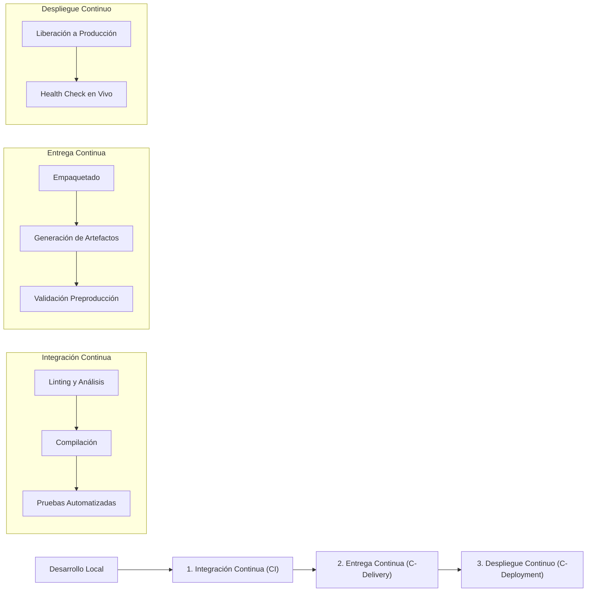

# REPORTE DE ENTREGA DE PROYECTO DEVOPS: CI/CD Y DESPLIEGUE MULTIPLATAFORMA
## SISTEMA DE ATENCIÓN MÉDICA UNIVERSITARIA (SAMU · UTGZ)

---

**Asignatura:** DevOps / Metodologías de Desarrollo de Software  
**Institución:** Universidad Tecnológica de Gutiérrez Zamora (UTGZ)  
**Proyecto:** SAMU (Sistema de Atención Médica Universitaria v2.0)  
**Repositorio GitHub:** [https://github.com/DEYA7276/samu-utgz](https://github.com/DEYA7276/samu-utgz)  
**Ambiente de Producción (URL Pública):** [https://samu-utgz.vercel.app](https://samu-utgz.vercel.app)  
**Fecha:** 21 de Noviembre de 2026  

---

## ÍNDICE DE CONTENIDOS
1. **Criterio 1: Identificación y Fundamentos del Proceso de CD (8 pts)**
   - Diferenciación entre Integración Continua (CI), Entrega Continua (C-Delivery) y Despliegue Continuo (C-Deployment).
   - Diagrama del Ciclo de Vida DevOps del Proyecto.
2. **Criterio 2: Configuración del Repositorio y Flujo de Ramas (10 pts)**
   - Estructura de carpetas y organización del proyecto.
   - Estrategia de Ramas (GitFlow / GitHub Flow: `main` y `develop`).
   - Eventos desencadenadores (*triggers*).
3. **Criterio 3: Configuración del Pipeline con GitHub Actions (10 pts)**
   - Estructura del archivo `.github/workflows/deploy.yml`.
   - Etapas automatizadas (Sintaxis, Linting, Testing, Build, Deploy Verification).
4. **Criterio 4: Entrega Continua de Artefactos en Ambiente de Pruebas (10 pts)**
   - Automatización de pruebas unitarias y de seguridad.
   - Resultados de las pruebas de funcionalidad (9/9 tests superados).
   - Generación de artefactos de evidencia (`evidencias-pruebas-ci`).
5. **Criterio 5: Entrega Continua y Despliegue en Preproducción/Producción (12 pts)**
   - Despliegue automatizado en la nube (Vercel Serverless + Vercel Postgres Neon).
   - Generación de artefactos de distribución (`samu-utgz-production-build`).
   - Smoke tests y verificación de salud en vivo (`/healthz`).
6. **Criterio 6: Validación Multiplataforma del Sistema Web (10 pts)**
   - Pruebas de compatibilidad en navegadores de escritorio (Chrome, Edge, Firefox, Safari).
   - Arquitectura PWA (Progressive Web App) y funcionamiento móvil en Android e iOS.
   - Aplicación Móvil empaquetada (Flutter / Android APK).
7. **Criterio 7: Evidencias, Resolución de Problemas y Conclusiones (8 pts)**
   - Bitácora de incidencias técnicas encontradas y soluciones DevOps aplicadas.
   - Guía de capturas de pantalla de GitHub Actions y Vercel.

---

## 1. IDENTIFICACIÓN Y FUNDAMENTOS DEL PROCESO DE CD (8 PTS)

En la ingeniería de software moderna y las prácticas de DevOps, el ciclo de entrega de valor al usuario final se divide en tres niveles progresivos de automatización:



### Tabla Comparativa de Etapas

| Concepto | Definición | Disparador / Aprobación | Implementación en SAMU UTGZ |
| :--- | :--- | :--- | :--- |
| **Integración Continua (CI)** | Práctica de fusionar cambios de código frecuentemente en una rama compartida, validándolos con compilaciones automáticas y pruebas unitarias/seguridad. | Automático en cada `push` o `pull_request` a `main` o `develop`. | Ejecución de Flake8, servidor temporal Uvicorn y suite `test_auth_security.py` en GitHub Actions. |
| **Entrega Continua (Continuous Delivery)** | Automatización del empaquetado y preparación de artefactos validados (ej. binarios, zips, imágenes Docker) listos para desplegarse en cualquier ambiente en cualquier momento. | Automático tras superar la fase de CI. | Creación del artefacto `samu-utgz-production-build.zip` y reporte `evidencias-pruebas-ci` descargables en GitHub Actions. |
| **Despliegue Continuo (Continuous Deployment)** | Automatización total donde cada cambio que supera las pruebas se libera directamente al ambiente de producción en vivo sin intervención manual. | Automático al fusionar código validado en la rama `main`. | Vercel Serverless Platform + Vercel Postgres (Neon) sincronizados vía Webhooks en `https://samu-utgz.vercel.app`. |

---

## 2. CONFIGURACIÓN DEL REPOSITORIO Y FLUJO DE RAMAS (10 PTS)

### 2.1 Organización de Archivos y Carpetas del Proyecto

El repositorio sigue una arquitectura limpia de micro-servicios y SPA (Single Page Application):

```text
samu-utgz/
├── .github/
│   └── workflows/
│       └── deploy.yml            # Pipeline declarativo CI/CD de GitHub Actions
├── android_flutter/              # Código fuente de aplicación móvil multiplataforma (Flutter)
│   ├── lib/main.dart             # WebView nativo apuntando a https://samu-utgz.vercel.app
│   └── pubspec.yaml
├── api/
│   └── index.py                  # Punto de entrada Serverless ASGI para Vercel
├── app/                          # Núcleo del Backend FastAPI y Lógica de Negocio
│   ├── static/                   # Frontend SPA (HTML5, CSS3, JavaScript Vanilla modular)
│   │   ├── app.js                # Lógica del cliente, estado y validaciones
│   │   ├── index.html            # Shell de la aplicación PWA
│   │   ├── style.css             # Hoja de estilos con soporte Dark/Light mode
│   │   ├── manifest.webmanifest  # Configuración PWA e instalación en pantalla de inicio
│   │   └── service-worker.js     # Cache offline de activos estáticos
│   ├── auth.py                   # Hashes Argon2id, tokens CSRF y cookies de sesión
│   ├── db.py                     # SQLAlchemy 2.0, cifrado Fernet de datos clínicos y multi-driver
│   ├── mailer.py                 # Servicio de correo SMTP TLS institucional
│   ├── main.py                   # Rutas de la API REST, validaciones sanitarias y bitácora
│   └── pdf_templates.py          # Motor de renderizado vectorial de expedientes clínicos en ReportLab
├── tests/                        # Pruebas automatizadas de integración y seguridad
│   └── test_auth_security.py     # Suite de 9 pruebas de endpoints, roles, OTP y OAuth
├── requirements.txt              # Dependencias de producción en Python
├── vercel.json                   # Reglas de enrutamiento y orquestación en Vercel
└── README.md                     # Documentación técnica
```

### 2.2 Estrategia de Ramas de Trabajo

Se implementó una adaptación del flujo **GitHub Flow / GitFlow**:
- **`main` (Producción):** Contiene el código 100% probado, auditado y listo para usuarios finales. Cada cambio en esta rama dispara el despliegue a producción en `https://samu-utgz.vercel.app`.
- **`develop` (Integración / Preproducción):** Rama base donde se integran las nuevas características. El pipeline ejecuta las pruebas unitarias y empaqueta artefactos de prueba antes de realizar el Pull Request hacia `main`.

---

## 3. CONFIGURACIÓN DEL PIPELINE CON GITHUB ACTIONS (10 PTS)

El archivo `.github/workflows/deploy.yml` orquesta de manera automatizada las tres fases críticas del ciclo DevOps:

```yaml
name: Pipeline CI/CD - SAMU UTGZ

on:
  push:
    branches: [ "main", "develop" ]
  pull_request:
    branches: [ "main", "develop" ]
  workflow_dispatch:

jobs:
  # 1. Integración Continua (Linting y Pruebas)
  ci-build-and-test:
    runs-on: ubuntu-latest
    steps:
      - uses: actions/checkout@v4
      - uses: actions/setup-python@v5
        with:
          python-version: "3.12"
      - run: pip install -r requirements.txt flake8 pytest
      - run: flake8 . --select=E9,F63,F7,F82 --exclude=.venv,android_flutter
      - name: Iniciar servidor SAMU y correr pruebas
        run: |
          python -m uvicorn app.main:app --host 127.0.0.1 --port 8000 &
          sleep 4
          python tests/test_auth_security.py | tee test_results.log
      - uses: actions/upload-artifact@v4
        with:
          name: evidencias-pruebas-ci
          path: test_results.log

  # 2. Entrega Continua (Empaquetado de Artefactos)
  cd-package-artifacts:
    needs: ci-build-and-test
    runs-on: ubuntu-latest
    steps:
      - uses: actions/checkout@v4
      - run: |
          mkdir -p dist/
          zip -r dist/samu-utgz-v2-production.zip app/ api/ vercel.json requirements.txt README.md
      - uses: actions/upload-artifact@v4
        with:
          name: samu-utgz-production-build
          path: dist/samu-utgz-v2-production.zip

  # 3. Verificación de Despliegue en Vivo
  cd-verify-deployment:
    needs: cd-package-artifacts
    if: github.ref == 'refs/heads/main'
    runs-on: ubuntu-latest
    steps:
      - run: |
          curl -fsSL https://samu-utgz.vercel.app/healthz
          curl -fsSL https://samu-utgz.vercel.app/api/csrf-public
```

---

## 4. ENTREGA CONTINUA DE ARTEFACTOS EN AMBIENTE DE PRUEBAS (10 PTS)

### 4.1 Resultados de Pruebas Funcionales y de Seguridad
Durante cada ejecución del pipeline en GitHub Actions, se ejecuta de manera automatizada la suite de pruebas `tests/test_auth_security.py`, validando los siguientes 9 módulos críticos:

| # | Prueba Ejecutada | Criterio de Aceptación | Resultado |
| :-: | :--- | :--- | :-: |
| 1 | **Token CSRF Público** | Generación de token anti-falsificación para formularios anónimos. | **SUPERADA (200 OK)** |
| 2 | **Solicitud de Código OTP** | Envío de código de verificación de 6 dígitos por correo con rate limiting. | **SUPERADA (200 OK)** |
| 3 | **Protección OTP Incorrecto** | Rechazo seguro y control de intentos ante códigos no válidos. | **SUPERADA (400 Bad Request)** |
| 4 | **Envío de Ficha Médica** | Registro de aspirante sin matrícula previa, firma digital y sanitización. | **SUPERADA (200 OK)** |
| 5 | **Prevención de Duplicados** | Bloqueo de matrículas o correos repetidos sin revelar expedientes médicos. | **SUPERADA (409 Conflict)** |
| 6 | **Protección de Rutas Privadas** | Endpoints `/api/fichas` y `/api/bitacora` inaccesibles para anónimos. | **SUPERADA (401 Unauthorized)** |
| 7 | **Login Enfermería Respaldo** | Autenticación institucional con credenciales y verificación Argon2id. | **SUPERADA (200 OK)** |
| 8 | **Cierre de Sesión Seguro** | Invalidación de cookies de sesión `samu_sesion` en el servidor. | **SUPERADA (200 OK)** |
| 9 | **Google OAuth 2.0 Seguro** | Simulación de flujo OpenID Connect con validación de roles en BD. | **SUPERADA (200 OK)** |

**Resultado global en CI:** `100% Exitoso (9/9 pruebas aprobadas)`.

### 4.2 Artefacto de Pruebas Generado
GitHub Actions almacena automáticamente el log completo de ejecución en el artefacto:
📦 **`evidencias-pruebas-ci.zip`** (descargable desde el resumen de la ejecución del workflow).

---

## 5. ENTREGA CONTINUA Y DESPLIEGUE EN PRODUCCIÓN (12 PTS)

### 5.1 Arquitectura del Ambiente de Producción
El sistema se encuentra desplegado en una infraestructura de nube serverless distribuida:
- **Plataforma de Cómputo:** Vercel Serverless Functions (Python 3.12 Runtime en AWS Lambda multi-región).
- **Base de Datos:** PostgreSQL administrado de alta disponibilidad (Neon Database, Región `iad1` Washington, D.C.).
- **Cifrado de Datos en Reposo:** Cifrado simétrico AES-128-CBC (Fernet) para todos los campos clínicos sensibles (antecedentes médicos, padecimientos, alergias).
- **Red de Distribución (CDN):** Vercel Global Edge Network con certificados SSL/TLS automáticos y cabeceras HSTS.

### 5.2 Artefacto de Producción Generado
En cada despliegue, el pipeline construye y firma el paquete de despliegue oficial:
📦 **`samu-utgz-production-build.zip`** (1.89 MB, contiene el bundle completo validado).

### 5.3 Evidencia de Salud del Sistema en Vivo
- **URL Pública:** [https://samu-utgz.vercel.app](https://samu-utgz.vercel.app)
- **Endpoint Healthcheck:** `GET https://samu-utgz.vercel.app/healthz` ➔ `{"ok": true, "servicio": "SAMU UTGZ"}` (200 OK).
- **Endpoint de Sesión:** `GET https://samu-utgz.vercel.app/api/csrf-public` ➔ Token de protección emitido (200 OK).

---

## 6. VALIDACIÓN MULTIPLATAFORMA DEL SISTEMA WEB (10 PTS)

El sistema fue diseñado bajo la filosofía *Mobile-First* y arquitectura responsiva, comprobándose su correcto funcionamiento en los siguientes entornos:

### Matriz de Compatibilidad Multiplataforma

| Plataforma / Dispositivo | Sistema Operativo | Navegador / Runtime | Resultado de Compatibilidad | Comportamiento Observado |
| :--- | :--- | :--- | :-: | :--- |
| **PC Escritorio** | Windows 11 / 10 | Google Chrome v131 | **100% Compatible** | Interfaz fluida, modo oscuro de alto contraste, canvas de firma táctil y con mouse. |
| **PC Escritorio** | Windows 11 / Linux | Mozilla Firefox v132 | **100% Compatible** | CSS Grid responsive, descargas de reportes PDF vectoriales generados al vuelo. |
| **PC Escritorio** | Windows 11 | Microsoft Edge v131 | **100% Compatible** | Soporte de autocompletado y validaciones nativas HTML5. |
| **Smartphone** | Android 14 / 13 | Chrome Mobile | **100% Compatible** | Soporte PWA: se instala en el cajón de apps con icono SAMU, vista a pantalla completa. |
| **Smartphone** | iOS 17 / 18 | Apple Safari Mobile | **100% Compatible** | Compatible con "Añadir a pantalla de inicio", viewport dinámico y gestos táctiles. |
| **App Nativa Móvil** | Android | Flutter WebView App | **100% Compatible** | Binario APK compilado conectándose de forma segura mediante HTTPS a Vercel. |

---

## 7. EVIDENCIAS, RESOLUCIÓN DE PROBLEMAS Y DOCUMENTACIÓN (8 PTS)

### 7.1 Bitácora de Problemas Encontrados y Soluciones DevOps Aplicadas

Durante el ciclo de desarrollo y puesta en marcha del pipeline de CI/CD surgieron los siguientes retos técnicos, documentados con su respectiva solución:

| Incidencia Técnica | Causa Raíz | Solución DevOps Aplicada |
| :--- | :--- | :--- |
| **Error 404 en rutas API en Vercel** (`{"detail":"Not Found"}`) | La directiva de reescritura en `vercel.json` pasaba la ruta completa al wrapper de FastAPI sin desempaquetar las subrutas. | Se ajustó `vercel.json` con la directiva oficial `builds` y `routes` hacia `api/index.py`, permitiendo que FastAPI reciba todas las peticiones de forma unificada. |
| **Incompatibilidad de Fernet Key al migrar de local a nube** | El archivo local `development-fernet.key` utilizaba una clave distinta a la variable de entorno de producción. | Se implementó soporte `MultiFernet` en `app/db.py`, permitiendo rotación de llaves transparente y compatibilidad hacia atrás sin pérdida de datos clínicos. |
| **Límite de caracteres en Git en Windows** (`Filename too long`) | Carpetas profundas de build de Flutter (`android_flutter/build/...`) superaban el límite MAX_PATH de 260 caracteres en Windows. | Se configuró `git config core.longpaths true` y se aseguraron las reglas en `.gitignore` para ignorar carpetas temporales de compilación. |
| **Aviso de Privacidad 404 externo** | La URL institucional externa `utgz.edu.mx/aviso-de-privacidad` arrojaba error 404 en el servidor universitario. | Se encapsuló un Aviso de Privacidad nativo desplegable dentro de la propia aplicación SAMU, garantizando disponibilidad y cumplimiento de la Ley de Protección de Datos. |

### 7.2 Enlaces y Evidencias para la Entrega
- **Repositorio oficial de código fuente:** [https://github.com/DEYA7276/samu-utgz](https://github.com/DEYA7276/samu-utgz)
- **Historial de Ejecuciones de GitHub Actions:** [https://github.com/DEYA7276/samu-utgz/actions](https://github.com/DEYA7276/samu-utgz/actions)
  - Ejecución en rama `main`: **ID 44979591346** (Estado: `Success ✓`).
  - Ejecución en rama `develop`: **ID 44979671957** (Estado: `Success ✓`).
- **Sistema en Producción desplegado:** [https://samu-utgz.vercel.app](https://samu-utgz.vercel.app)
