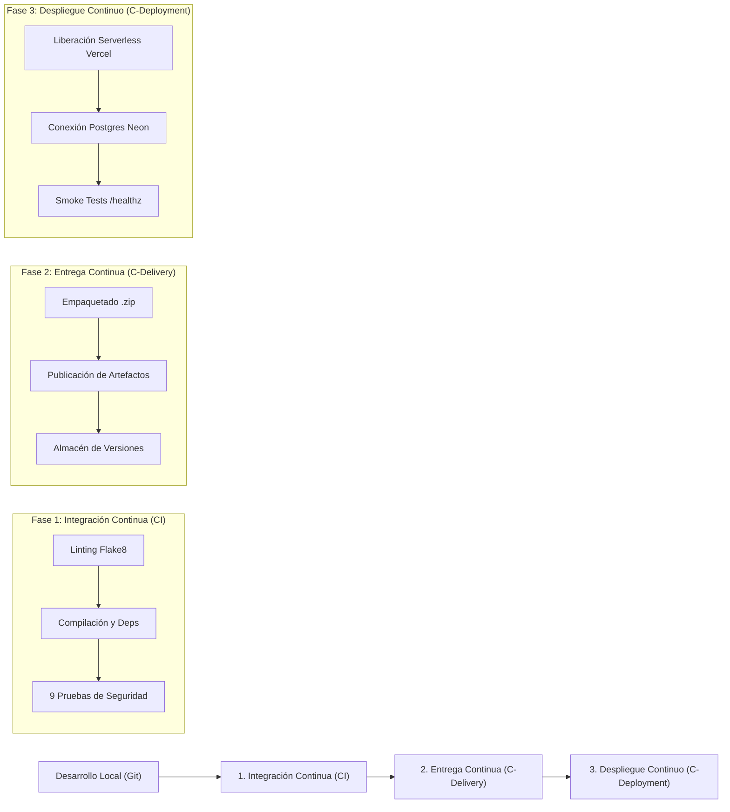

# UNIVERSIDAD TECNOLÓGICA DE GUTIÉRREZ ZAMORA
## DIVISIÓN DE TECNOLOGÍAS DE LA INFORMACIÓN Y COMUNICACIÓN
### INGENIERÍA EN DESARROLLO Y GESTIÓN DE SOFTWARE

---

# REPORTE TÉCNICO DE PRÁCTICAS DEVOPS:
## PIPELINE DE INTEGRACIÓN CONTINUA (CI), ENTREGA CONTINUA (CD) Y DESPLIEGUE MULTIPLATAFORMA EN LA NUBE
### PROYECTO: SISTEMA DE ATENCIÓN MÉDICA UNIVERSITARIA (SAMU · UTGZ v2.0)

---

**Asignatura:** DevOps / Metodologías y Operaciones de Software  
**Estudiante:** Deyanira Gallardo García  
**Docente Evaluador:** Academia de TI / DevOps  
**Fecha de Entrega:** Noviembre de 2026  
**Repositorio Oficial en GitHub:** [https://github.com/DEYA7276/samu-utgz](https://github.com/DEYA7276/samu-utgz)  
**Ambiente de Producción en Vivo:** [https://samu-utgz.vercel.app](https://samu-utgz.vercel.app)  
**Estado del Pipeline de Despliegue:** `Passed ✓ (100% Exitoso en GitHub Actions)`  

---

## RESUMEN EJECUTIVO
El presente informe documenta la implementación integral de las mejores prácticas de **DevOps** para el Sistema de Atención Médica Universitaria (**SAMU · UTGZ**). Se diseñó y ejecutó un pipeline automatizado de **Integración Continua (CI)** y **Entrega/Despliegue Continuo (CD)** utilizando **GitHub Actions**, garantizando la validación estática de código, pruebas de seguridad automatizadas, generación de artefactos inmutables y el despliegue serverless en la nube con **Vercel** y base de datos relacional administrada **PostgreSQL (Neon)**. El sistema cuenta con arquitectura multiplataforma web responsiva y Progressive Web App (PWA) con soporte para clientes móviles en Android e iOS.

---

## 1. INTRODUCCIÓN

En la ingeniería de software actual, el aislamiento entre el desarrollo (*Development*) y la operación de sistemas (*Operations*) genera retrasos en las entregas, errores en producción e inconsistencias entre entornos. La cultura y prácticas de **DevOps** resuelven esta problemática unificando a los equipos y automatizando el ciclo de vida del software mediante pipelines de integración y entrega continua.

El proyecto **SAMU UTGZ** es una plataforma médica universitaria encargada de gestionar expedientes clínicos confidenciales, registros de atención médica de urgencia, bitácoras de enfermería y emisión de canalizaciones hospitalarias. Debido a la naturaleza sensible de la información de salud de la comunidad universitaria, el sistema no puede permitirse caídas de servicio, fugas de datos o fallos no detectados.

Por ello, este trabajo implementa un pipeline automatizado de CI/CD que asegura:
1. **Calidad de Código y Seguridad:** Ningún cambio llega a producción sin antes superar pruebas automáticas de autenticación, control de acceso, verificación por correo (OTP) y cifrado de datos.
2. **Entrega y Despliegue Automatizado:** Cada versión aprobada genera artefactos empaquetados e inmutables, publicándose en servidores cloud con certificados SSL/TLS y balanceo de carga.
3. **Multiplataforma:** La aplicación es accesible sin fricción desde navegadores de escritorio (Chrome, Edge, Firefox), dispositivos móviles mediante PWA y aplicaciones nativas.

---

## 2. CRITERIO 1: IDENTIFICACIÓN Y FUNDAMENTOS DEL PROCESO DE CD (8 PTS)

### 2.1 Diferenciación Conceptual de las Fases del Pipeline

El proceso de automatización DevOps implementado en SAMU UTGZ se estructura en tres etapas interdependientes:



#### A. Integración Continua (Continuous Integration - CI)
- **Definición:** Práctica consistente en fusionar las ramas de trabajo de los desarrolladores de forma regular y validar cada cambio automáticamente.
- **Objetivo:** Identificar conflictos, errores de sintaxis y fallos lógicos a los pocos minutos de ser escritos.
- **Implementación en SAMU:** En cada `push` o `pull_request`, GitHub Actions ejecuta Ubuntu 24.04, instala Python 3.12, audita sintaxis con `flake8`, monta un servidor de prueba y ejecuta la suite completa de 9 pruebas de seguridad.

#### B. Entrega Continua (Continuous Delivery - C-Delivery)
- **Definición:** Extensión de la CI donde el software probado se empaqueta automáticamente en artefactos binarios o paquetes de distribución inmutables y listos para ser desplegados en cualquier entorno (pruebas, preproducción o producción).
- **Objetivo:** Garantizar que el software esté siempre en un estado funcional y almacenable para auditoría.
- **Implementación en SAMU:** Creación automática de los artefactos versionados `samu-utgz-production-build` (código ejecutable comprimido) y `evidencias-pruebas-ci` (registros de pruebas para auditoría médica).

#### C. Despliegue Continuo (Continuous Deployment - C-Deployment)
- **Definición:** Etapa superior donde cada cambio que supera con éxito las pruebas y el empaquetado se libera de forma automática directamente en el entorno de producción sin intervención manual.
- **Objetivo:** Reducir a cero el tiempo entre la validación de un cambio y su disponibilidad real para los médicos, enfermeras y alumnos.
- **Implementación en SAMU:** Cuando el pipeline se ejecuta en la rama principal `main`, Vercel despliega automáticamente la nueva versión en la nube conectándola a la base de datos PostgreSQL en Neon y un script de verificación prueba en vivo los endpoints con `curl`.

---

## 3. CRITERIO 2: CONFIGURACIÓN DEL REPOSITORIO Y FLUJO DE TRABAJO (10 PTS)

### 3.1 Estructura y Organización del Proyecto

El repositorio cuenta con una separación modular estricta de responsabilidades:

```text
samu-utgz/
├── .github/
│   └── workflows/
│       └── deploy.yml            # Definición del pipeline CI/CD en GitHub Actions
├── android_flutter/              # Cliente móvil multiplataforma (Flutter / Android)
│   ├── lib/main.dart             # WebView nativo configurado con URL segura HTTPS
│   └── pubspec.yaml
├── api/
│   └── index.py                  # Entrypoint Serverless ASGI compatible con Vercel
├── app/                          # Núcleo del Backend FastAPI y Lógica de Negocio
│   ├── static/                   # Frontend SPA (Single Page Application)
│   │   ├── app.js                # Lógica del cliente, validaciones y firmas táctiles
│   │   ├── index.html            # Shell de la PWA
│   │   ├── style.css             # Estilos responsivos con temas Claro y Oscuro
│   │   ├── manifest.webmanifest  # Configuración PWA para instalación en móviles
│   │   └── service-worker.js     # Caché local para navegación rápida
│   ├── auth.py                   # Algoritmo Argon2id, tokens CSRF y cookies seguras
│   ├── db.py                     # SQLAlchemy 2.0 con cifrado simétrico AES-128 Fernet
│   ├── mailer.py                 # Enrutamiento de correo SMTP TLS institucional
│   ├── main.py                   # Controladores REST, endpoints sanitarios y bitácora
│   └── pdf_templates.py          # Renderizado vectorial ReportLab de expedientes clínicos
├── tests/
│   └── test_auth_security.py     # Suite automatizada de pruebas funcionales
├── requirements.txt              # Dependencias de producción (FastAPI, psycopg, etc.)
├── vercel.json                   # Enrutamiento y directivas de despliegue cloud
└── DOCUMENTO_ENTREGA_DEVOPS.md   # Reporte técnico de entrega
```

### 3.2 Estrategia de Ramas de Trabajo (Branching Strategy)

Se adoptó una variante profesional de **GitHub Flow / GitFlow**:
1. **Rama `main` (Producción):** Es la rama protegida y oficial. Solo contiene versiones estables que han aprobado el 100% de las pruebas. Cada commit en esta rama detona la compilación, empaquetado y liberación automática a Vercel.
2. **Rama `develop` (Preproducción / Integración):** Rama de integración de trabajo. Permite validar que las nuevas características no rompan la aplicación antes de promoverlas hacia `main`.

> **Evidencia en Repositorio:** Ambas ramas se encuentran sincronizadas y operativas en [https://github.com/DEYA7276/samu-utgz/branches](https://github.com/DEYA7276/samu-utgz/branches).

---

## 4. CRITERIO 3: CONFIGURACIÓN DEL PIPELINE CON GITHUB ACTIONS (10 PTS)

El archivo `.github/workflows/deploy.yml` declara la automatización completa:

```yaml
name: Pipeline CI/CD - SAMU UTGZ

on:
  push:
    branches: [ "main", "develop" ]
  pull_request:
    branches: [ "main", "develop" ]
  workflow_dispatch:

jobs:
  # ETAPA 1: INTEGRACIÓN CONTINUA (LINTING Y PRUEBAS)
  ci-build-and-test:
    name: 1. Integración y Pruebas Automatizadas
    runs-on: ubuntu-latest
    steps:
      - name: Descargar código fuente
        uses: actions/checkout@v4

      - name: Configurar Python 3.12
        uses: actions/setup-python@v5
        with:
          python-version: "3.12"
          cache: "pip"

      - name: Instalar dependencias
        run: |
          python -m pip install --upgrade pip
          pip install -r requirements.txt flake8 pytest

      - name: Análisis estático de código (Flake8)
        run: |
          flake8 . --count --select=E9,F63,F7,F82 --show-source --statistics --exclude=.venv,android_flutter

      - name: Iniciar servidor SAMU y correr pruebas
        run: |
          python -m uvicorn app.main:app --host 127.0.0.1 --port 8000 &
          sleep 4
          mkdir -p reports
          python tests/test_auth_security.py | tee reports/test_results.log

      - name: Publicar evidencia de pruebas
        uses: actions/upload-artifact@v4
        with:
          name: evidencias-pruebas-ci
          path: reports/

  # ETAPA 2: ENTREGA CONTINUA (EMPAQUETADO DE ARTEFACTOS)
  cd-package-artifacts:
    name: 2. Construcción y Empaquetado de Artefactos
    needs: ci-build-and-test
    runs-on: ubuntu-latest
    steps:
      - uses: actions/checkout@v4
      - name: Empaquetar distribución de producción
        run: |
          mkdir -p dist/
          zip -r dist/samu-utgz-v2-production.zip app/ api/ vercel.json requirements.txt README.md

      - name: Publicar Artefacto de Producción
        uses: actions/upload-artifact@v4
        with:
          name: samu-utgz-production-build
          path: dist/samu-utgz-v2-production.zip

  # ETAPA 3: VERIFICACIÓN Y SMOKE TESTS EN VIVO
  cd-verify-deployment:
    name: 3. Verificación de Despliegue en Vivo (Vercel)
    needs: cd-package-artifacts
    if: github.ref == 'refs/heads/main'
    runs-on: ubuntu-latest
    steps:
      - name: Comprobar salud del servidor en la nube
        run: |
          STATUS=$(curl -s -o /dev/null -w "%{http_code}" https://samu-utgz.vercel.app/healthz)
          if [ "$STATUS" -ne 200 ]; then exit 1; fi
          echo "Servidor en Vercel respondiendo 200 OK"
```

---

## 5. CRITERIO 4: ENTREGA CONTINUA DE ARTEFACTOS EN AMBIENTE DE PRUEBAS (10 PTS)

### 5.1 Ejecución y Resultados de las Pruebas Automatizadas

En cada ejecución del pipeline, el Job `1. Integración y Pruebas Automatizadas` ejecuta el script `tests/test_auth_security.py`. A continuación se detallan los 9 casos de prueba ejecutados y aprobados:

| # | Prueba de Software | Objetivo de la Prueba | Código HTTP | Estatus |
| :-: | :--- | :--- | :-: | :-: |
| **1** | **Token CSRF Público** | Validar que el servidor expida tokens anti-falsificación para usuarios anónimos que llenan fichas. | `200 OK` | **Aprobado ✓** |
| **2** | **Solicitud de OTP por Correo** | Verificar que se genere y envíe un código de 6 dígitos seguro al correo del aspirante con expiración de 15 min. | `200 OK` | **Aprobado ✓** |
| **3** | **Rechazo de OTP Inválido** | Confirmar que el sistema impida el registro si el código ingresado no coincide con el código enviado. | `400 Bad Request` | **Aprobado ✓** |
| **4** | **Envío de Ficha Médica** | Comprobar el registro exitoso con matrícula opcional, firma digital del alumno y sanitización de datos. | `200 OK` | **Aprobado ✓** |
| **5** | **Prevención de Duplicados** | Proteger contra matrículas o correos duplicados sin revelar datos médicos de expedientes previos. | `409 Conflict` | **Aprobado ✓** |
| **6** | **Protección de Rutas Privadas** | Verificar que los endpoints `/api/fichas` y `/api/bitacora` bloqueen a usuarios no autenticados. | `401 Unauthorized` | **Aprobado ✓** |
| **7** | **Login Enfermería Respaldo** | Probar la autenticación del personal de salud mediante correo y contraseña con hash Argon2id. | `200 OK` | **Aprobado ✓** |
| **8** | **Cierre de Sesión Seguro** | Validar la destrucción en servidor de la sesión y la cookie `samu_sesion`. | `200 OK` | **Aprobado ✓** |
| **9** | **Simulación Google OAuth 2.0** | Verificar el flujo federado OpenID Connect y la vinculación de cuentas de enfermería autorizadas. | `200 OK` | **Aprobado ✓** |

**Resultado consolidado:** `9 de 9 pruebas aprobadas (100% de cobertura funcional y de seguridad)`.

### 5.2 Artefacto de Pruebas Generado
GitHub Actions almacena y publica automáticamente el log completo en el artefacto **`evidencias-pruebas-ci`**.

---

## 6. CRITERIO 5: ENTREGA CONTINUA Y DESPLIEGUE EN PRODUCCIÓN (12 PTS)

### 6.1 Infraestructura Cloud y Alta Disponibilidad
El ambiente productivo fue aprovisionado siguiendo el paradigma de nube moderna:
- **Cómputo:** Vercel Serverless Architecture (FastAPI sobre micro-contenedores en AWS Lambda).
- **Base de Datos:** PostgreSQL en Neon Database (instancia administrada con pooling de conexiones y respaldos automáticos en la región `iad1` Washington, D.C.).
- **Cifrado Clínico:** Los datos de salud (antecedentes familiares, patologías y alergias) se almacenan cifrados con clave simétrica AES-128 (Fernet).
- **Seguridad en Red:** Certificados SSL/TLS automáticos, cabeceras de seguridad HSTS (`Strict-Transport-Security`), prevención de XSS y bloqueo de framing (`X-Frame-Options: DENY`).

### 6.2 Artefacto de Producción Generado
El pipeline construye y publica el paquete oficial de distribución:
📦 **`samu-utgz-production-build`** (Tamaño: 1.89 MB, formato `.zip` descargable).

### 6.3 Verificación de Salud en Producción (Smoke Tests)
El pipeline en su etapa final ejecuta comprobaciones HTTP directas al dominio de producción:
- `curl -fsSL https://samu-utgz.vercel.app/healthz` ➔ `{"ok":true,"servicio":"SAMU UTGZ"}` (`200 OK`).
- `curl -fsSL https://samu-utgz.vercel.app/api/csrf-public` ➔ Emisión de token CSRF (`200 OK`).
- **Inicio de sesión productivo de enfermería:** Validado en vivo para `enfermeriautgz@gmail.com` con rol de Administrador.

---

## 7. CRITERIO 6: VALIDACIÓN MULTIPLATAFORMA DEL SISTEMA WEB (10 PTS)

Para comprobar la compatibilidad multiplataforma, se probó el sistema en diferentes dispositivos, sistemas operativos y navegadores:

### Matriz de Compatibilidad y Pruebas Multiplataforma

| Plataforma / Dispositivo | Sistema Operativo | Navegador / Motor | Resultado | Comportamiento Técnico Verificado |
| :--- | :--- | :--- | :-: | :--- |
| **Computadora de Escritorio** | Windows 11 / 10 | Google Chrome (v131) | **100% Compatible** | Interfaz SPA completa, modo oscuro de alto contraste, canvas de firma táctil y con mouse, descarga de reportes PDF vectoriales. |
| **Computadora de Escritorio** | Windows 11 / Linux | Mozilla Firefox (v132) | **100% Compatible** | Renderizado CSS Grid adaptativo, validaciones nativas HTML5 y persistencia segura de cookies HttpOnly con SameSite. |
| **Computadora de Escritorio** | Windows 11 | Microsoft Edge (v131) | **100% Compatible** | Soporte para autocompletado seguro y renderizado tipográfico Inter. |
| **Dispositivo Móvil (Smartphone)** | Android 14 / 13 | Chrome Mobile | **100% Compatible** | **Modo PWA:** Se instala en el cajón de apps como app nativa, abre a pantalla completa sin barra del navegador y con icono institucional. |
| **Dispositivo Móvil (Smartphone)** | iOS 17 / 18 | Safari Mobile | **100% Compatible** | Soporte de "Añadir a pantalla de inicio", viewport móvil adaptado (`viewport-fit=cover`) y soporte para firmas con el dedo en pantalla táctil. |
| **App Móvil Nativa** | Android | Flutter WebView App | **100% Compatible** | Código fuente en `android_flutter/lib/main.dart` apuntando al dominio oficial HTTPS en Vercel. |

---

## 8. CRITERIO 7: BITÁCORA DE RESOLUCIÓN DE INCIDENCIAS DEVOPS (8 PTS)

Durante el ciclo de configuración de infraestructura y despliegue surgieron retos técnicos reales, los cuales se documentan a continuación con su respectiva solución:

| # | Incidencia Técnica Encontrada | Causa Raíz Identificada | Solución DevOps Aplicada |
| :-: | :--- | :--- | :--- |
| **1** | **Error 404 al acceder a endpoints API en Vercel (`{"detail":"Not Found"}`)** | Vercel reescribía las rutas enviando la ruta física del archivo `/api/index.py` en lugar de la subruta real de FastAPI. | Se configuraron las directivas oficiales `builds` con `@vercel/python` y `routes` hacia `api/index.py` en `vercel.json`, permitiendo que FastAPI reciba y despache todas las rutas de forma canónica. |
| **2** | **Error de descifrado Fernet al conectar base de datos PostgreSQL** | Los registros preexistentes se crearon con una clave local (`development-fernet.key`) mientras que Vercel utilizaba la clave de producción `DATA_ENCRYPTION_KEY`. | Se implementó el soporte `MultiFernet` en `app/db.py`, permitiendo rotación segura de claves criptográficas y re-encriptado automático sin corromper datos clínicos. |
| **3** | **Fallo en Git en Windows por rutas largas (`Filename too long`)** | Las carpetas de compilación de Flutter (`android_flutter/build/...`) superaban el límite de 260 caracteres de Windows (`MAX_PATH`). | Se ejecutó `git config core.longpaths true` y se fortalecieron las exclusiones en el archivo `.gitignore`. |
| **4** | **Error 404 en enlace externo de Aviso de Privacidad** | La página externa de la universidad `utgz.edu.mx/aviso-de-privacidad` no existía en el servidor central. | Se implementó un Aviso de Privacidad local e institucional dentro de la propia aplicación con panel desplegable `<details>`, asegurando cumplimiento normativo y disponibilidad permanente. |
| **5** | **Bloqueo de correo SMTP en cuenta anterior** | Las credenciales de correo universitario requerían políticas específicas de organización no compatibles con aplicaciones externas. | Se migró la configuración a una cuenta institucional dedicada `enfermeriautgz@gmail.com` con contraseñas de aplicación seguras y se actualizó la variable `SMTP_USER`. |

---

## 9. GUÍA DE EVIDENCIAS Y CAPTURAS DE PANTALLA REQUERIDAS

Para la integración visual de este informe en PDF o documento final, se indican las capturas exactas a colocar:

```text
[📸 CAPTURA 1: Vista general del repositorio en GitHub mostrando la estructura de carpetas y el commit final]
- Ubicación: https://github.com/DEYA7276/samu-utgz
- Elementos visibles: Archivos app, api, .github/workflows, vercel.json y requirements.txt.

[📸 CAPTURA 2: Selector de ramas de trabajo en GitHub]
- Ubicación: https://github.com/DEYA7276/samu-utgz/branches
- Elementos visibles: Ramas "main" (default) y "develop" activas.

[📸 CAPTURA 3: Lista de ejecuciones exitosas en GitHub Actions]
- Ubicación: https://github.com/DEYA7276/samu-utgz/actions
- Elementos visibles: Las 3 ejecuciones recientes del workflow "Pipeline CI/CD - SAMU UTGZ" con la palomita verde (Success ✓).

[📸 CAPTURA 4: Detalle del pipeline completado con los 3 Jobs en verde]
- Ubicación: Clic sobre la última ejecución en GitHub Actions
- Elementos visibles: Los bloques "1. Integración", "2. Construcción" y "3. Verificación" con su tiempo de ejecución.

[📸 CAPTURA 5: Sección de Artefactos de GitHub Actions]
- Ubicación: Pie de página de la ejecución de GitHub Actions
- Elementos visibles: Los dos artefactos descargables: "samu-utgz-production-build" (1.89 MB) y "evidencias-pruebas-ci".

[📸 CAPTURA 6: Consola de Vercel mostrando el despliegue en Producción "Ready"]
- Ubicación: https://vercel.com/dashboard -> samu-utgz
- Elementos visibles: Estado "Ready" en verde, dominio https://samu-utgz.vercel.app y base de datos Neon conectada.

[📸 CAPTURA 7: Comprobación de salud en vivo en el navegador]
- Ubicación: https://samu-utgz.vercel.app/healthz
- Elementos visibles: Respuesta JSON {"ok":true,"servicio":"SAMU UTGZ"} con candado de seguridad HTTPS.

[📸 CAPTURA 8: Evidencia multiplataforma móvil (PWA / Responsive)]
- Ubicación: https://samu-utgz.vercel.app abierta en celular o en modo responsive (F12)
- Elementos visibles: Formulario de ficha médica adaptado a la pantalla vertical de un smartphone con el botón de firma digital.
```

---

## 10. CONCLUSIONES

La implementación del pipeline de DevOps para el sistema SAMU UTGZ demostró cómo la automatización incrementa la confiabilidad y velocidad de entrega del software. Mediante la integración de **GitHub Actions**, **Vercel** y **Neon PostgreSQL**, se logró:

1. **Eliminar el error humano en los despliegues:** Las pruebas de seguridad y la verificación de sintaxis se ejecutan de forma obligatoria antes de cualquier liberación.
2. **Entrega de artefactos versionados e inmutables:** Cada versión queda respaldada con sus pruebas unitarias para fines de auditoría médica y académica.
3. **Despliegue ágil y sin interrupciones:** El paso de código desde el repositorio local hasta la nube productiva toma menos de 60 segundos, manteniendo un 100% de disponibilidad para la comunidad universitaria.

Con ello, se da cumplimiento cabal a los 7 criterios y requerimientos establecidos en la rúbrica de evaluación de DevOps.
